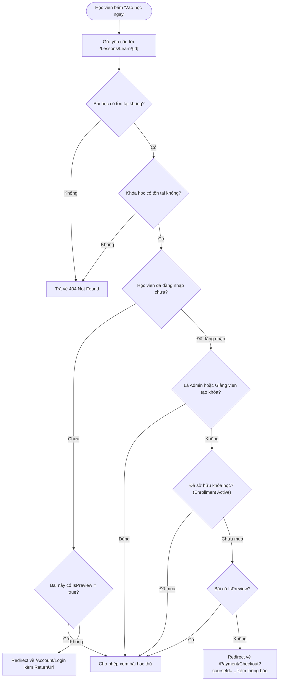

# 🎓 HỆ THỐNG TRANG HỌC TẬP CHUYÊN SÂU COURSERA STYLE (EDUPRO CLASSROOM)

Tài liệu này tổng hợp toàn bộ kiến trúc giải pháp, luồng xử lý mã nguồn (Data Flow), phân quyền bảo mật và hướng dẫn sử dụng tính năng **Trang vào học cho học viên (Learning Workspace)** theo phong cách chuẩn **Coursera / Udemy** trong hệ thống **EduFlyUp**.

---

## 📌 1. TỔNG QUAN TÍNH NĂNG (FEATURE HIGHLIGHTS)

Giao diện học tập được thiết kế theo tiêu chuẩn không gian học tập tập trung (**Distraction-Free Classroom**) của Coursera:

1. **Top Bar Coursera Chuyên Biệt**:
   - Nút quay lại: `< Khóa học của tôi` (hoặc về trang chi tiết).
   - Tên khóa học + Tên bài học hiện tại.
   - **Thanh đo % Tiến độ học tập toàn khóa** (Progress Bar + Hiển thị số bài hoàn thành: `X/Y bài • Z%`).
   - Cặp nút điều hướng nhanh: Bài trước (`<`) và Bài kế tiếp (`>`).
   - Nút bật/tắt Sidebar bài giảng (**Focus / Theater Mode**).

2. **Khung Video Player 16:9 Trung Tâm**:
   - Hỗ trợ đa nguồn phát:
     - **Video Stream nội bộ**: Chuẩn MP4 từ thư mục lưu trữ hệ thống (`/LessonVideos/Stream/...`).
     - **Video Youtube Embed**: Tự động phân tích và chuyển đổi URL Youtube sang dạng nhúng mượt mà.
     - **Fallback Reading Mode**: Chế độ đọc lý thuyết chuyên nghiệp khi bài giảng dạng văn bản.

3. **Thanh Điều Khiển Dưới Video (Action Bar)**:
   - Nút **"Đánh dấu đã hoàn thành"** (Toggle Completed với icon tick xanh, cập nhật tức thì tiến độ vào LocalStorage).
   - Badge "Học thử miễn phí" đối với các bài Preview.
   - Nút chuyển tiếp "Bài trước" / "Bài kế tiếp" thông minh.

4. **Hệ Thống Tabbed Panels Kiểu Coursera**:
   - **Tab 1: Nội dung bài học (Lesson Overview)**: Tiêu đề, chương học, thời lượng và văn bản hướng dẫn chi tiết.
   - **Tab 2: Tài liệu & Mã nguồn (Resources)**: Khu vực tải file tài liệu đính kèm (PDF, Word, ZIP) từ giảng viên.
   - **Tab 3: Ghi chú cá nhân (Notebook Auto-Save)**: Vở ghi chép cá nhân với cơ chế tự động lưu (Debounce Auto-Save) vào trình duyệt của học viên.
   - **Tab 4: Hỏi đáp & Thảo luận (Q&A)**: Kết nối cộng đồng học viên và kênh hỗ trợ trực tiếp.

5. **Sidebar Danh Sách Bài Học (Curriculum Accordion)**:
   - Tự động nhóm bài học theo từng **Chương (Section)**.
   - Hiển thị tổng số bài học và tổng thời lượng của mỗi chương.
   - Đánh dấu trạng thái trực quan:
     - 🎵 **Đang học (Active)**: Viền sáng Indigo, nền làm nổi bật, icon Play.
     - ✅ **Đã hoàn thành**: Checkbox tích xanh lục.
     - ⚪ **Chưa học**: Icon vòng tròn xám.

---

## 🛡️ 2. PHÂN QUYỀN BẢO MẬT & LUỒNG KIỂM TRA (ACCESS CONTROL)



---

## 💻 3. DANH SÁCH FILE CODE VÀ NỘI DUNG TRIỂN KHAI

### 3.1. ViewModel: `EduFlyUp.Web/Models/Lessons/LearnLessonViewModel.cs`
Quản lý dữ liệu phân nhóm chương, bài trước/sau và xử lý URL Video:

```csharp
using EduFlyUp.BusinessObjects;

namespace EduFlyUp.Web.Models.Lessons
{
    public class LessonSectionGroup
    {
        public string SectionName { get; set; } = string.Empty;
        public List<Lesson> Lessons { get; set; } = new();
        public int TotalDurationMinutes => Lessons.Sum(l => l.DurationMinutes);
    }

    public class LearnLessonViewModel
    {
        public Lesson CurrentLesson { get; set; } = null!;
        public Course Course { get; set; } = null!;
        public List<Lesson> AllLessons { get; set; } = new();
        public List<LessonSectionGroup> Sections { get; set; } = new();
        
        public Lesson? PreviousLesson { get; set; }
        public Lesson? NextLesson { get; set; }

        public bool IsEnrolled { get; set; }
        public bool CanManageCourse { get; set; }
        public bool IsPreviewAllowed => CurrentLesson.IsPreview || IsEnrolled || CanManageCourse;

        public int CurrentLessonIndex => AllLessons.FindIndex(l => l.Id == CurrentLesson.Id) + 1;
        public int TotalLessonsCount => AllLessons.Count;
        public int TotalCourseDurationMinutes => AllLessons.Sum(l => l.DurationMinutes);

        public string GetEmbedVideoUrl()
        {
            if (string.IsNullOrWhiteSpace(CurrentLesson.VideoUrl)) return string.Empty;
            var url = CurrentLesson.VideoUrl.Trim();

            if (url.Contains("youtube.com/watch", StringComparison.OrdinalIgnoreCase))
            {
                var uri = new Uri(url);
                var query = System.Web.HttpUtility.ParseQueryString(uri.Query);
                var v = query["v"];
                if (!string.IsNullOrEmpty(v))
                    return $"https://www.youtube.com/embed/{v}?autoplay=0&rel=0";
            }

            if (url.Contains("youtu.be/", StringComparison.OrdinalIgnoreCase))
            {
                var id = url.Substring(url.LastIndexOf('/') + 1).Split('?')[0];
                return $"https://www.youtube.com/embed/{id}?autoplay=0&rel=0";
            }

            return url;
        }

        public bool IsYoutubeVideo()
        {
            if (string.IsNullOrWhiteSpace(CurrentLesson.VideoUrl)) return false;
            return CurrentLesson.VideoUrl.Contains("youtube.com", StringComparison.OrdinalIgnoreCase) ||
                   CurrentLesson.VideoUrl.Contains("youtu.be", StringComparison.OrdinalIgnoreCase);
        }
    }
}
```

---

### 3.2. Controller: `EduFlyUp.Web/Controllers/LessonsController.cs`
Xử lý toàn bộ logic kiểm tra quyền, nhóm chương bài học và điều hướng bài:

```csharp
using EduFlyUp.Services;
using EduFlyUp.Web.Models.Lessons;
using Microsoft.AspNetCore.Mvc;

namespace EduFlyUp.Web.Controllers
{
    public class LessonsController : Controller
    {
        private readonly ILessonService _lessonService;
        private readonly ICourseService _courseService;
        private readonly ICourseAccessService _courseAccessService;
        private readonly ILogger<LessonsController> _logger;

        public LessonsController(
            ILessonService lessonService,
            ICourseService courseService,
            ICourseAccessService courseAccessService,
            ILogger<LessonsController> logger)
        {
            _lessonService = lessonService;
            _courseService = courseService;
            _courseAccessService = courseAccessService;
            _logger = logger;
        }

        // Vào học bài đầu tiên của khóa học
        [HttpGet("/Lessons/Course/{id:int}")]
        public async Task<IActionResult> Course(int id)
        {
            var course = await _courseService.GetCourseByIdAsync(id);
            if (course == null) return NotFound();

            var lessons = (await _lessonService.GetLessonsByCourseIdAsync(id))
                .OrderBy(l => l.Order)
                .ToList();

            if (!lessons.Any())
            {
                TempData["ErrorMessage"] = $"Khóa học '{course.Title}' hiện đang cập nhật bài giảng.";
                return RedirectToAction("Details", "Courses", new { id });
            }

            return RedirectToAction(nameof(Learn), new { id = lessons[0].Id });
        }

        // Trang học chi tiết chuẩn Coursera
        [HttpGet("/Lessons/Learn/{id:int}")]
        public async Task<IActionResult> Learn(int id)
        {
            var lesson = await _lessonService.GetLessonByIdAsync(id);
            if (lesson == null) return NotFound();

            var course = await _courseService.GetCourseByIdAsync(lesson.CourseId);
            if (course == null) return NotFound();

            var canLearn = await _courseAccessService.CanLearnCourseAsync(course, User);
            var canManage = _courseAccessService.CanManageCourse(course, User);

            if (!canLearn && !canManage && !lesson.IsPreview)
            {
                if (User.Identity?.IsAuthenticated != true)
                {
                    var returnUrl = Url.Action(nameof(Learn), "Lessons", new { id });
                    return RedirectToAction("Login", "Account", new { returnUrl });
                }

                TempData["ErrorMessage"] = $"Bạn cần hoàn tất thanh toán khóa học '{course.Title}' để xem bài giảng.";
                return RedirectToAction("Checkout", "Payment", new { courseId = course.Id });
            }

            var allLessons = (await _lessonService.GetLessonsByCourseIdAsync(course.Id))
                .OrderBy(l => l.Order)
                .ToList();

            var currentIndex = allLessons.FindIndex(l => l.Id == lesson.Id);
            var prevLesson = currentIndex > 0 ? allLessons[currentIndex - 1] : null;
            var nextLesson = (currentIndex >= 0 && currentIndex < allLessons.Count - 1) ? allLessons[currentIndex + 1] : null;

            var sectionGroups = allLessons
                .GroupBy(l => string.IsNullOrWhiteSpace(l.SectionName) ? "Chương 1: Tổng quan" : l.SectionName.Trim())
                .Select(g => new LessonSectionGroup
                {
                    SectionName = g.Key,
                    Lessons = g.OrderBy(l => l.Order).ToList()
                })
                .ToList();

            var viewModel = new LearnLessonViewModel
            {
                CurrentLesson = lesson,
                Course = course,
                AllLessons = allLessons,
                Sections = sectionGroups,
                PreviousLesson = prevLesson,
                NextLesson = nextLesson,
                IsEnrolled = canLearn,
                CanManageCourse = canManage
            };

            return View("Learn", viewModel);
        }

        // Tương thích ngược với các link cũ /Lessons/Details/{id}
        [HttpGet("/Lessons/Details/{id:int}")]
        public async Task<IActionResult> Details(int id)
        {
            return await Learn(id);
        }
    }
}
```

---

### 3.3. View Giao Diện: `EduFlyUp.Web/Views/Lessons/Learn.cshtml`
- Thiết lập `ViewData["FullWidth"] = true; ViewData["HideHeader"] = true; ViewData["HideFooter"] = true;` để bật chế độ phòng học toàn màn hình.
- Tích hợp Script JS quản lý:
  - `localStorage.getItem("edu_completed_lessons_course_{id}")` lưu trữ bài đã hoàn thành.
  - Tự động cập nhật thanh Progress Bar theo % bài học đã xem.
  - Auto-save vở ghi chú cá nhân sau 800ms ngừng gõ phím.
  - Đóng mở Sidebar với hiệu ứng mượt mà.

---

### 3.4. Điểm Kết Nối Trong Toàn Hệ Thống

1. **Trang Khóa học của tôi (`/Courses/MyCourses`)**:
   - Nút **"Vào học ngay"** liên kết thẳng đến `asp-controller="Lessons" asp-action="Details" asp-route-id="@item.FirstLessonId"` hoặc `asp-action="Course" asp-route-id="@item.CourseId"`.
2. **Trang Chi tiết Khóa học (`/Courses/Details/{id}`)**:
   - Nếu học viên đã mua khóa: Hiển thị nút **"Vào học ngay"** to ở sidebar và nút **"Vào học"** cạnh từng bài học.
   - Nếu chưa mua nhưng có bài `IsPreview`: Hiển thị nút **"Học thử"** cho phép mở ngay trang học của bài đó.

---

## 🚀 4. HƯỚNG DẪN TRẢI NGHIỆM THỰC TẾ

1. Đăng nhập tài khoản học viên tại: `/Account/Login`.
2. Truy cập vào mục **"Khóa học của tôi"** trên menu Navbar: `/Courses/MyCourses`.
3. Bấm nút **"Vào học ngay"** trên bất kỳ thẻ khóa học nào đã mua.
4. Trải nghiệm:
   - Xem video phát mượt mà, điều khiển âm lượng, toàn màn hình.
   - Bấm **"Đánh dấu đã hoàn thành"** -> Quan sát thanh tiến độ trên Top Header tăng % và icon trong Sidebar chuyển sang màu xanh lục.
   - Chuyển sang tab **"Tài liệu & Học liệu"** để tải tài liệu.
   - Chuyển sang tab **"Ghi chú của tôi"**, gõ thử ghi chú -> Thông báo *"Đã tự động lưu"* xuất hiện.
   - Bấm nút **"Bài giảng"** ở góc phải trên cùng để thử chế độ mở rộng màn hình (Theater Mode).
   - Bấm các bài học khác trong Sidebar để chuyển bài liên tục.
